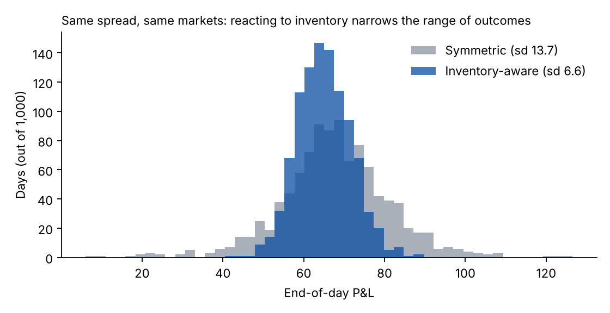
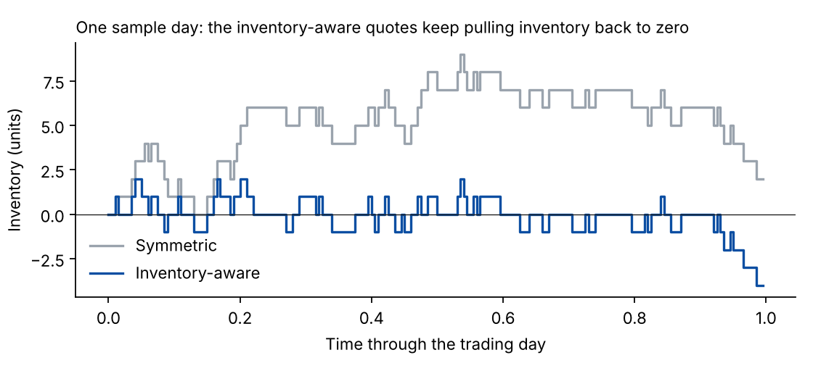
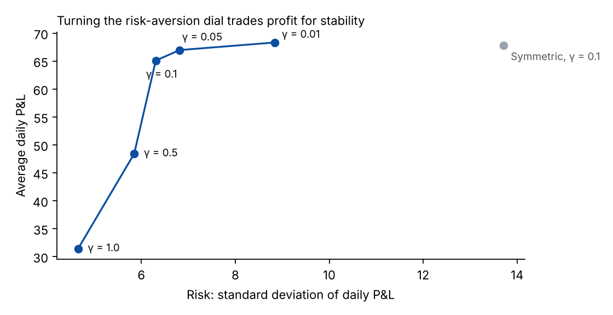
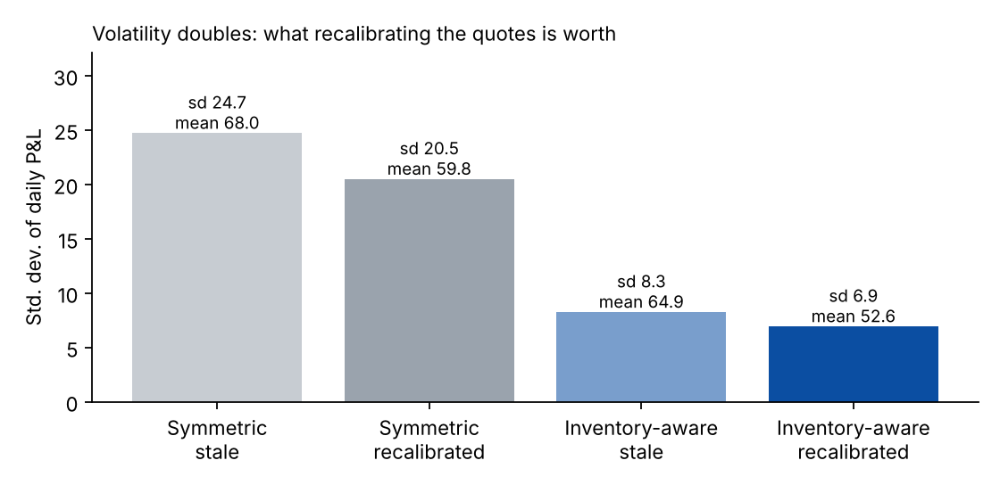

# Market-Making Simulator: Inventory Risk and Volatility Shocks

A market maker quotes a price to buy (the bid) and a price to sell (the ask), and earns the gap between them. The catch is inventory. Every time only one side trades, the market maker is left holding stock, and that stock loses money if the price moves the wrong way.

This project simulates 1,000 trading days to answer two questions:

1. **How much risk does a market maker remove by adjusting quotes for inventory, and what does it cost in profit?**
2. **When volatility suddenly doubles, what protects the market maker more: an inventory rule, or recalibrating to the new volatility?**

The first question reproduces a classic result (Avellaneda and Stoikov, 2008). The second is my own extension.

## The two strategies

| | Symmetric | Inventory-aware (Avellaneda-Stoikov) |
|---|---|---|
| Where quotes are centred | On the mid price, always | On a *reservation price* that moves away from the mid as inventory builds |
| Spread | Same formula as the inventory-aware strategy | Same formula, so the inventory rule is the only difference |
| Long 5 units? | Keeps quoting the same | Lowers both quotes: sells more readily, buys less readily |

The reservation price is `r = mid - inventory × γ × σ² × (time left)`, where γ is the market maker's risk aversion. The more inventory, the higher the volatility and the more time left in the day, the harder the quotes lean.

## Results

**1. Reacting to inventory halves the risk for a 4% cut in profit.** (γ = 0.1, 1,000 days each)

| Strategy | Average daily P&L | Std. dev. of P&L | Profit per unit of risk | Average absolute inventory |
|---|---|---|---|---|
| Symmetric | 67.8 | 13.7 | 4.95 | 6.7 |
| Inventory-aware | 65.0 | 6.6 | 9.80 | 2.4 |



The inventory-aware market maker gives up 4% of average profit, cuts the standard deviation of daily P&L by 52%, and roughly doubles profit per unit of risk. Its inventory stays close to zero all day:



**2. Risk aversion is a dial, not a free lunch.** Raising γ makes the market maker lean harder on inventory and quote wider. Risk keeps falling, but past γ ≈ 0.1 profit falls much faster than risk does.



**3. Extension: volatility doubles from σ = 2 to σ = 4.** I compared each strategy when its quotes are *stale* (still set for σ = 2) and when they are *recalibrated* to σ = 4.

| Strategy | Quotes | Average P&L | Std. dev. of P&L |
|---|---|---|---|
| Symmetric | Stale | 68.0 | 24.7 |
| Symmetric | Recalibrated | 59.8 | 20.5 |
| Inventory-aware | Stale | 64.9 | 8.3 |
| Inventory-aware | Recalibrated | 52.6 | 6.9 |



What I took from this:

* **The inventory rule does most of the protecting.** When volatility doubled, the symmetric market maker's risk rose 80% (13.7 to 24.7). The inventory-aware one, still running the *wrong* volatility, saw risk rise only 24% (6.6 to 8.3). Its risk ended up at a third of the symmetric strategy's.
* **Recalibrating is insurance with a high premium.** Updating the inventory-aware quotes to the new volatility cut risk a further 16% but cost 19% of average profit, because higher volatility widens the spread and fewer orders fill.
* **For a desk, the order of priorities is clear:** control inventory first, then decide how fast to recalibrate based on how much profit you are willing to give up for stability.

## Limitations

This is a simplified model, and the answers depend on it:

* Prices follow a random walk with no trends, jumps or mean reversion.
* Order arrivals depend only on distance from the mid. In real markets, order flow is clustered, and informed traders hit quotes just before the price moves (adverse selection), which this model ignores.
* There are no competing market makers, fees, latency or inventory limits.
* The volatility shock lasts the whole day. Real shocks arrive mid-session and fade.

The natural next steps would be adding adverse selection (orders that predict the next price move) and a hard inventory limit, then checking whether the conclusions above still hold.

## Run it

```bash
pip install -r requirements.txt
python run_experiments.py          # regenerates every number and chart above
python -m unittest test_simulator  # sanity checks on quotes and results
```

All simulations use fixed random seeds, so the results reproduce exactly.

## Files

```
simulator.py         quoting rules and the day-by-day simulation
run_experiments.py   the three experiments, charts and summary table
test_simulator.py    unit tests
*.png, summary.csv   charts and results table
```

## Reference

Avellaneda, M. and Stoikov, S. (2008). High-frequency trading in a limit order book. *Quantitative Finance*, 8(3), 217–224.

Ahmad Hussain · Trinity College Dublin · hussaiah@tcd.ie
